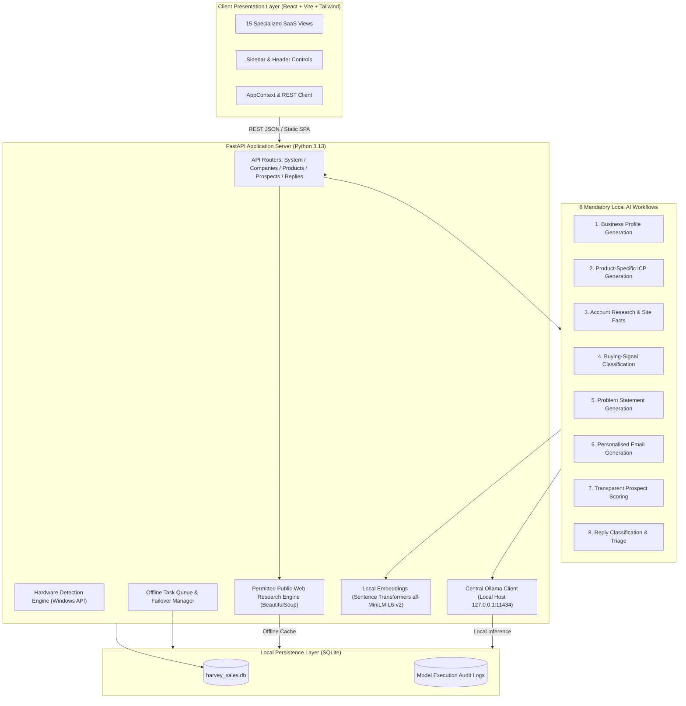

# Harvey Local Sales Agent — Technical Documentation

## 1. System Architecture Overview

Harvey Local Sales Agent is an autonomous, multi-product B2B sales development platform re-architected to operate with **Zero LLM Cost** using local open-weight models via Ollama.



---

## 2. Multi-Company & Multi-Product Data Isolation

Unlike the upstream single-tenant Harvey CLI, Harvey 2.0 implements a strict multi-tenant relational schema:

```text
Company (Organization)
 ├── Products (1-to-Many: e.g. KubeGuard AI, LogStream Pro)
 │    ├── ICP Profiles (1-to-1 per Product)
 │    ├── Problem Statements (Product-specific pain points)
 │    └── Generated Emails (Product-specific sales copy)
 └── Prospects (Accounts owned by Company)
      ├── Research Dossier (Site facts & verified observations)
      ├── Buying Signals (Hiring, expansion, tech stack changes)
      ├── Prospect Scores (Multi-factor score evaluated against active Product)
      └── Conversation Replies (Inbound triage & rep responses)
```

### Relational Schema (SQLite / SQLAlchemy)
1. `companies`: Holds organizational context, domains, business notes, and AI-synthesized executive profiles.
2. `products`: Stores product descriptions, categories, pricing models, value propositions, and key features.
3. `icp_profiles`: Product-specific ICP criteria including target industries, company sizes, decision makers, buying triggers, and disqualifiers.
4. `prospects`: Company-level directory with contact names, roles, emails, domains, status, and scores.
5. `prospect_research`: Cached web scraping results, tech stack tags, verified observations, and explicitly missing/unavailable facts.
6. `buying_signals`: Detected commercial growth events with confidence ratings and sales implications.
7. `problem_statements`: Causal mapping between prospect bottlenecks and product features with severity ratings.
8. `prospect_scores`: Transparent breakdown of ICP fit (0-40), signal confidence (0-40), and reachability (0-20).
9. `generated_emails`: Multi-step outreach sequences with subject lines, hooks, value props, and CTAs.
10. `conversation_replies`: Inbound prospect messages classified into 5 categories with sentiment and drafted answers.
11. `model_execution_logs`: Immutable audit trail of every prompt, latency in milliseconds, token counts, and offline status.
12. `task_queue`: Deferred tasks queued during local model restarts.

---

## 3. Central Ollama Service & Failure Handling
Located at `backend/services/ollama_service.py`:
- Connects to local daemon at `http://127.0.0.1:11434`.
- Employs sub-30ms socket probing (`_is_port_open`) to verify daemon availability before initiating HTTP handshakes.
- When Ollama is available:
  - Dispatches requests via `POST /api/generate` with temperature 0.3.
  - Formats responses into strict JSON structures.
  - Logs latency and token metrics to `ModelExecutionLog`.
- When Ollama is unavailable:
  - **Zero Cloud Leak:** Never redirects requests to external cloud APIs.
  - **Queueing:** Inserts the task payload into the SQLite `TaskQueue` table (`status="pending"`).
  - **Deterministic Continuity:** Returns a deterministic, rule-based preview marked with `is_deterministic_preview = True` so users are never blocked during demonstration.

---

## 4. Hardware Detection Logic
Located at `backend/services/hardware_service.py`:
- Uses the native Windows Win32 API (`GlobalMemoryStatusEx` via `ctypes`) to read exact physical RAM without slow WMI queries.
- Inspects CPU logical processors and root drive free disk space.
- Classifies machine into one of three hardware tiers:
  1. *Entry / Constrained Memory* (<8 GB): Recommends `qwen2.5:1.5b`.
  2. *Standard Modern Laptop* (8–16 GB): Recommends `qwen2.5:3b`.
  3. *High-Performance Workstation* (>16 GB): Recommends `qwen2.5:7b`.
- Explains model download sizes and parameters to prevent unintended large downloads.

---

## 5. Permitted Public-Web Research Engine
Located at `backend/services/research_service.py`:
- Uses `urllib.robotparser` with an async 2.0s timeout to inspect target `robots.txt` files.
- Extracts page title, meta description, JSON-LD Schema.org markup, and signature-based web technologies (Next.js, React, Stripe, WordPress, etc.).
- Enforces user-agent: `HarveyLocalSalesAgent/2.0 (Permitted Research Bot; Respects robots.txt)`.
- Adheres to SSRF safety boundaries (retaining upstream Harvey's `public_http.py` IP address validation).
- Distinguishes **Verified Observations** (confirmed web facts) from **Unavailable Information** (withheld budget numbers).
- In offline mode (`OFFLINE_MODE = True`), outbound HTTP traffic is rejected and previously stored local facts are served immediately.

---

## 6. The 8 Mandatory Local AI Workflows

| # | Workflow | Primary Service File | Key Inputs | Generated Output |
|---|---|---|---|---|
| **1** | **Business Profile Generation** | `workflows/business_profile.py` | Local business notes, industry, domain | Vertical, business model, differentiators, sales context |
| **2** | **Product-Specific ICP** | `workflows/icp_generator.py` | Product details, category, pricing, pain points | Target industries, sizes, decision makers, buying triggers, disqualifiers, pitch angle |
| **3** | **Prospect Research** | `workflows/prospect_research.py` | Domain, local cached facts | Tech stack, verified observations, unavailable facts disclosure |
| **4** | **Buying-Signal Classification** | `workflows/buying_signals.py` | Account facts, hiring data | Signal categorization, confidence (0.7-0.99), sales implication |
| **5** | **Problem Statement Generation** | `workflows/problem_statements.py` | Prospect profile + active product | Severity (high/med/low), connection to product, rep talk-track |
| **6** | **Personalised Email Generation** | `workflows/email_generator.py` | Observations + signals + problem | Grounded subject line, opening hook, value prop, low-friction CTA |
| **7** | **Prospect Scoring** | `workflows/prospect_scorer.py` | ICP fit, signals, reachability | 0-100 overall score, category badge, 3-metric breakdown, AI rationale |
| **8** | **Reply Classification** | `workflows/reply_classifier.py` | Inbound prospect email message | Intent classification (5 classes), sentiment, objections, suggested response |

---

## 7. API Endpoints Reference

| Method | Endpoint | Description |
|---|---|---|
| `GET` | `/api/system/health` | Ollama connection, active model, offline status, task queue count |
| `GET` | `/api/system/hardware` | Host CPU, RAM, GPU, free disk, hardware tier recommendation |
| `GET` | `/api/system/logs` | Audit trail of local model inferences with latency |
| `GET` | `/api/system/queue` | Deferred offline tasks |
| `POST` | `/api/system/toggle-offline` | Toggle network isolation mode |
| `GET` | `/api/companies` | List all organizations |
| `POST` | `/api/companies` | Register new organization |
| `POST` | `/api/companies/{id}/generate-profile` | Trigger Workflow 1 (Business Profile Generation) |
| `GET` | `/api/products` | List products (filterable by `company_id`) |
| `POST` | `/api/products` | Add new product under company |
| `POST` | `/api/products/{id}/generate-icp` | Trigger Workflow 2 (Product-Specific ICP Generation) |
| `GET` | `/api/prospects` | List prospects (filterable by status, search, company) |
| `POST` | `/api/prospects/import-csv` | Upload CSV with automatic deduplication |
| `POST` | `/api/prospects/{id}/research` | Trigger Workflow 3 (Prospect Research) |
| `POST` | `/api/prospects/{id}/classify-signals` | Trigger Workflow 4 (Buying Signals) |
| `POST` | `/api/prospects/{id}/generate-problems` | Trigger Workflow 5 (Problem Statements) |
| `POST` | `/api/prospects/{id}/generate-email` | Trigger Workflow 6 (Personalised Email Generation) |
| `POST` | `/api/prospects/{id}/score` | Trigger Workflow 7 (Prospect Scoring) |
| `POST` | `/api/replies/classify` | Trigger Workflow 8 (Reply Classification) |
| `GET` | `/api/replies` | Historical conversation replies |
| `POST` | `/api/seed/load-sample-data` | Seed or reset demonstration environment |
